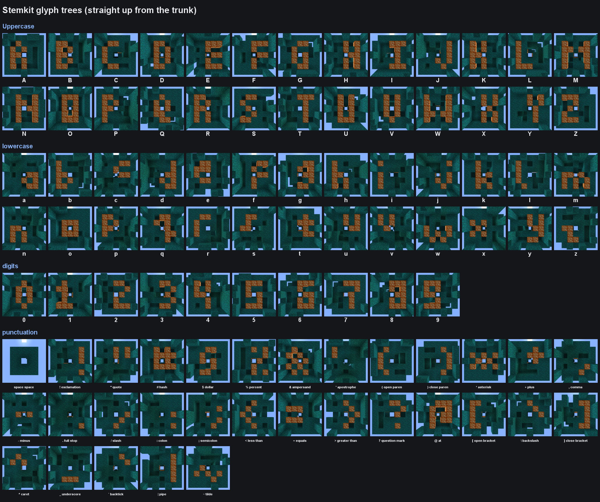
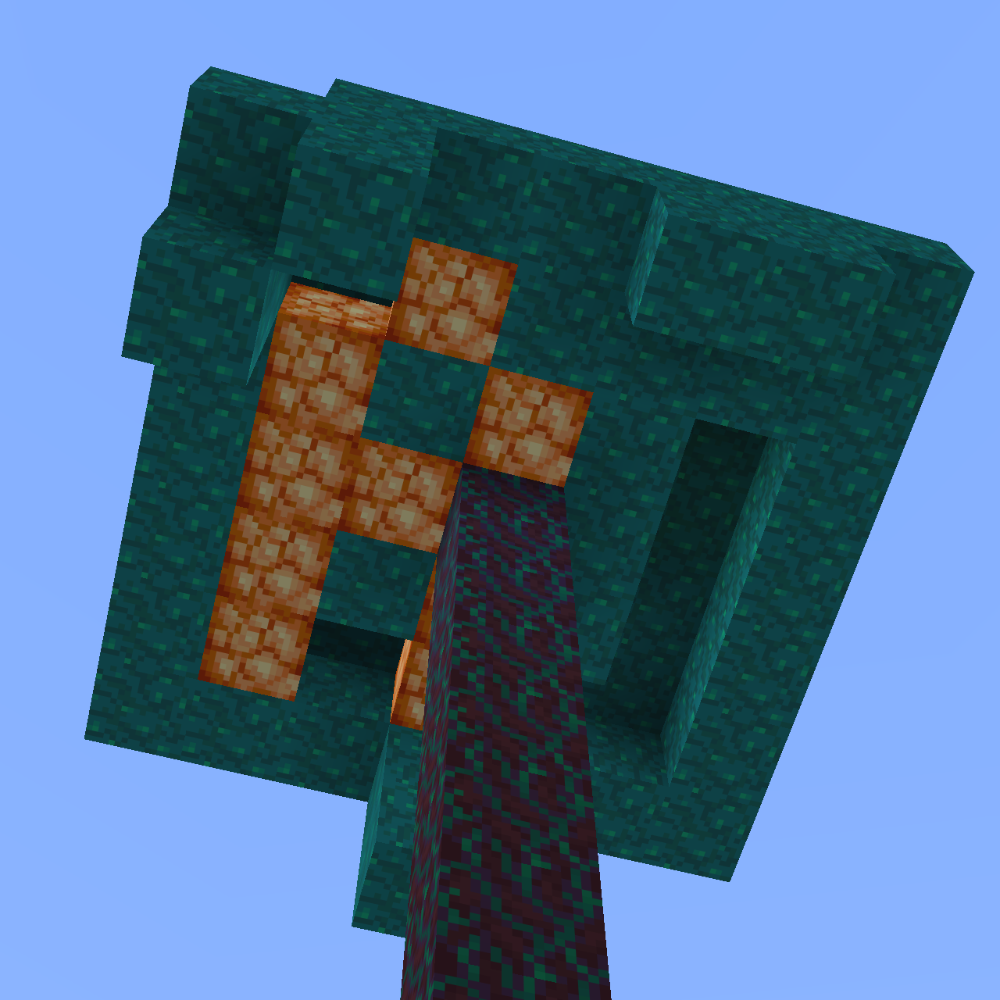
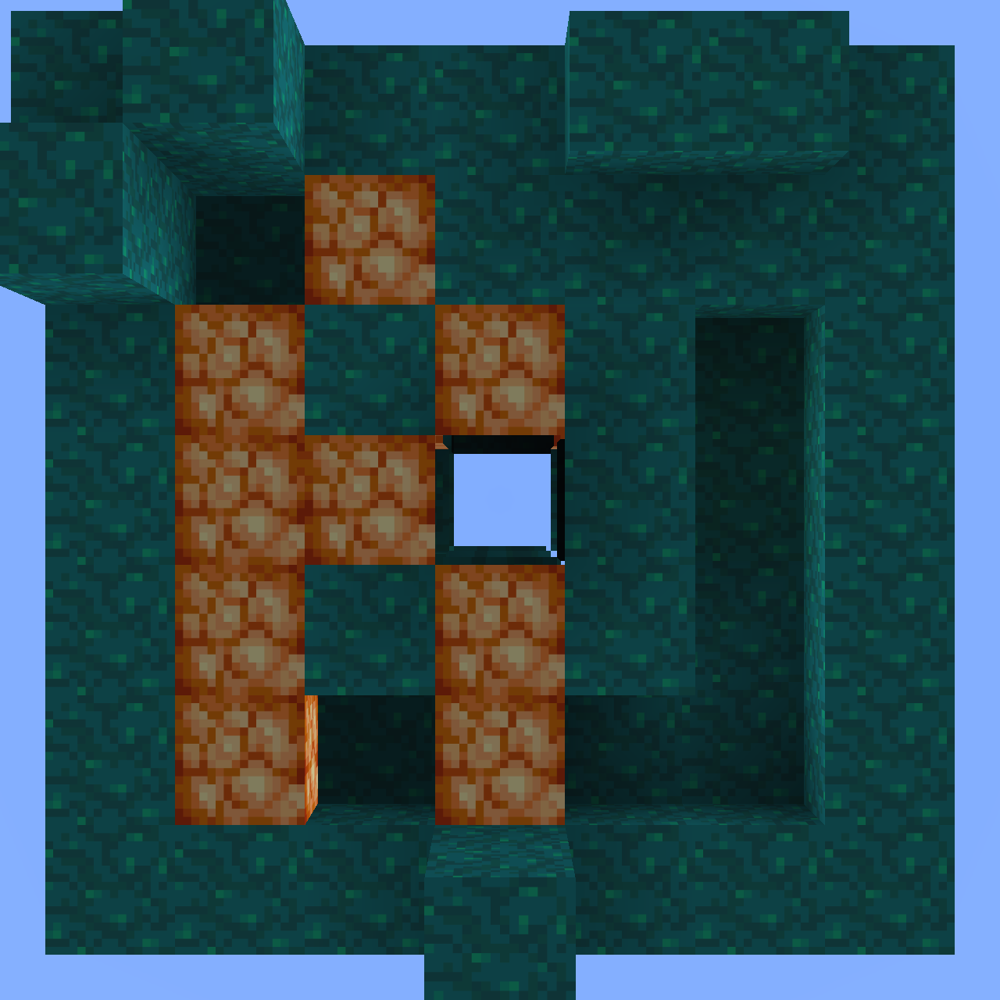

# Stemkit

A small Fabric mod for Minecraft 26.3 that grows huge Nether fungi from an exact RNG state, so a tree you found once can be grown again whenever you want. It has all of ASCII written in shroomlights (from real bone-mealed trees too), a catalogue of interesting trees, and sibling trees: the same bone meal roll grown as warped and as crimson, which sometimes come out identical ([what that means](docs/SIBLINGS.md)).

Every tree is grown by the game's own bone meal code (or its natural worldgen code), using the exact random state that made it. Glyph trees get turned (and the odd punctuation mark shifted) so they sit where they should, and that is the only change the mod makes to a tree.



## Install

You need Fabric Loader 0.20 or newer. Fabric API is not needed. Drop `stemkit-<version>.jar` into your `mods` folder.

Commands need operator level 2 (gamemaster), so cheats must be on in singleplayer.

To build it yourself you need Java 25:

```
cd mod
./gradlew build
```

The jar ends up in `mod/build/libs`.

## Before you run anything

Growing a tree clears the space it needs first: a 7x7 column for bone meal trees, 9x9 for natural ones, from the floor up to about 30 blocks. It also lays a nylium floor under it. Run these in a flat creative world or an empty patch, not in a base you care about.

Where the tree goes: if you're looking at a block within reach, the tree grows on top of it. Otherwise it grows 6 blocks in front of you at foot level. The grow, sibling and char commands also take an optional `[pos]` (three coordinates) if you want to place it exactly. If the spot is too close to the top or bottom of the world, the tree is moved to fit and the game tells you.

## Commands

Run `/stemkit` on its own to see the version, who made it and the list of commands.

### `/stemkit grow`

This is the main one. What it does depends on what you put after it.

| Command | What it does |
|---|---|
| `/stemkit grow` | Lists every named tree, colour coded. Hover a name for details. Clicking one puts its command in your chat box and you press Enter. |
| `/stemkit grow <name> [pos]` | Grows a named tree from the catalogue. |
| `/stemkit grow all [pos]` | Grows every tree that has the data to be rebuilt, side by side in framed rows, with a sign by each one showing its name and seed. |
| `/stemkit grow <seed> [pos]` | Grows a warped fungus from a raw bone meal seed (see below). |
| `/stemkit grow warped <seed> [pos]`<br>`/stemkit grow crimson <seed> [pos]` | Same, but you choose the variant. |

Names are checked first. If what you typed isn't a name, it's treated as a seed. Tree names can't be made only of digits, so the two never clash.

After growing a named tree the game prints its shroomlight and wart counts and says whether they match what was recorded. Matching counts is a good sign you got the right tree, though it only compares those two totals.

**Seeds.** A bone meal seed is the internal state of the world's random generator, just before the bone meal is used. It's a whole number from 0 to 281474976710655. Any number in that range is a valid starting state, so the tree it grows is one vanilla bone meal can make. Reaching that state in survival is not covered here. About 6 in 10 seeds fail the bone meal success roll and produce nothing, same as in the real game.

For natural trees (the ones that generate in the world) the catalogue stores the world seed and position, and the mod rebuilds the tree from those. Two catalogue trees come from a feature seed instead and have no world.

### `/stemkit sibling <seed> [pos]`

Grows the same seed twice, warped on the left and crimson on the right, and compares them block by block, ignoring vines. It tells you if they are identical, the same shape, or different.

Most seeds give two trees that split early and look nothing alike. Roughly 1 in 10,000 gives an identical sibling pair, the same down to the shroomlights. [This page](docs/SIBLINGS.md) explains the difference between siblings and identical siblings. See the research notes for why.

### `/stemkit seed`

Tells you the random state of a tree you've just seen grow, and saves it in the format `trees.json` uses, so you can add it to the catalogue.

| Command | What it does |
|---|---|
| `/stemkit seed` | The tree nearest to you (within 48 blocks) that the mod saw growing. |
| `/stemkit seed last` | The most recent bone meal tree, wherever it is. |

The game doesn't remember a tree's seed, so the mod watches fungi as they grow and notes the state at that moment. That means:

- **Bone meal (or a dispenser):** works for any tree grown while the mod is loaded. You get the seed, and `/stemkit grow warped <seed>` (or `crimson`) grows it again.
- **Natural trees:** only caught while their chunk is first generated with the mod installed, so walk into fresh Nether chunks and then run the command next to a tree. Trees in chunks that already existed can't be recovered. You get the world seed, the position and the generator's state, which is enough to rebuild the tree. Only the last few thousand are remembered, and nothing survives a restart.

The command saves the entry to `config/stemkit/captured_trees.json`, and the chat message has a link that copies it. Paste the entry into the `trees` list in `config/stemkit/trees.json`, give it a better name and a description if you like, and `/reload`. The new tree then shows up in `/stemkit grow`.

### `/stemkit char`

The glyph trees. Each one is a bone meal tree whose shroomlights spell a single character in one layer of the hat. You stand under it and look straight up to read it.

| Command | What it does |
|---|---|
| `/stemkit char` | Lists every available glyph. |
| `/stemkit char <glyph> [pos]` | Grows one. A letter (case matters), a digit, or a punctuation name like `question_mark`, `full_stop` or `ampersand`. |
| `/stemkit char all [pos]` | Everything, in four straight lines: lowercase, uppercase, digits, punctuation. There's a gap between the lines. |
| `/stemkit char all_alpha` | All lowercase letters in one line. |
| `/stemkit char ALL_ALPHA` | All uppercase letters in one line. |
| `/stemkit char all_num` | The digits. |
| `/stemkit char all_punct` | The punctuation. |

Every glyph tree is turned when it's placed so it reads the right way up for the direction you were facing when you ran the command. Face the way you want to walk along the line, run it, then walk under the trees looking up. Lines run away from you.

Fourteen characters share a tree with another one, because the same pattern reads as both depending on which way you look at it: W and M, i and !, H and K, 6 and 9 and so on. That makes 95 characters on 81 trees.




### `/stemkit message <text>`

Spells out whatever you type as one straight line of glyph trees running away from you. Spaces become the blank space tree. Anything that has no tree is left as a gap and the game lists what it skipped.

```
/stemkit message hello world
```

### `/stemkit xray [radius]`

Swaps the wart blocks near you for stained glass so you can see the shroomlights hidden inside a hat. The default radius is 42 blocks (maximum 48). Run it again to put the wart back. The original blocks are only remembered until you leave the world, so restore them before you log off.

## The tree catalogue

`/stemkit grow` lists about fifty trees. A few kinds of them:

- **Record natural trees.** The 58 and 59 shroomlight warped trees (`warped_titan_58`, `warped_record_59`) and a few other finds from real 1.21.11 worlds, rebuilt from their world seed and position. Rebuilt in 26.3 they come out with the same counts, but the terrain around them in a real 26.3 world may differ. A natural tree has about a 1 in 2.4 quadrillion chance of reaching 58 shroomlights, and about 1 in 7.5 quadrillion of reaching 59.
- **Search trees.** Two natural crimson trees with 44 and 45 shroomlights from a sampled search (`model_crimson_45`). They have no world, so they only show what the natural code makes from that state.
- **Bone meal extremes.** The biggest hat (245 wart blocks), trees with 31 shroomlights, the tallest bare stem, the smallest possible tree.
- **Odd shapes.** A pagoda, a table on four legs, a lollipop, a spiral staircase of shroomlights, a hat that is completely hollow, a wart cube. They're mostly named for what they look like.
- **Siblings.** Warped and crimson pairs from one seed, for example `sibling_most_glow`.

Each one has a short description. They live in `trees.json`. The first time the mod runs it copies that file to `config/stemkit/trees.json`, where you can add your own trees or edit the existing ones. Run `/reload` to pick up changes. A new jar version replaces your copy, and keeps the old one next to it as a `.bak` file.

The glyph list works the same way in `config/stemkit/glyphs.json`.

## Where this came from

The glyph trees came from a brute force search over every possible bone meal state. The sibling pairs came from the same kind of search over a small slice of the space. The method, the run time and the results are in [docs/RESEARCH.md](docs/RESEARCH.md), and the search scripts are in [research/](research).

## Licence

MIT. See [LICENSE](LICENSE).
