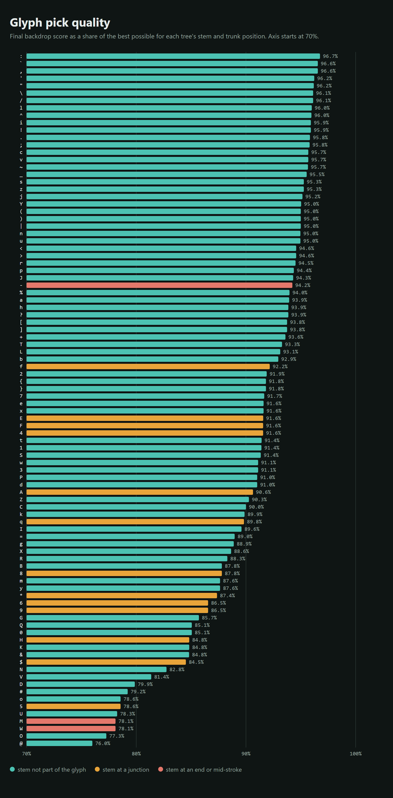

# How the glyphs and sibling trees were found

Two parts of Stemkit came out of one idea: the alphabet trees and the warped and crimson sibling pairs. If one number decides the whole tree, you can just try the numbers.

The scripts are in [research/](../research), and this page covers the method and the results.

## Why one number is enough

When you use bone meal on a Nether fungus, the game rolls a 40% chance of success and then grows the tree. All the randomness comes from one generator, the world's level random. That generator is a 48-bit linear congruential generator, the same old Java one used all over Minecraft. It has a full period, so it can sit in any of 2^48 (about 281 trillion) states, and the game can be in any of them.

Pick a state, use bone meal, and the whole tree follows: its height, how wide the hat is, which blocks are wart, which are shroomlight, where the vines hang. Same state, same tree. About 40% of states pass the success roll, which leaves roughly 1.1 × 10^14 trees to look through per variant.

So "find a tree that does X" turns into "check 10^14 candidates". That's a lot, but a GPU is fast at running one small check over and over.

## The alphabet

### What a glyph tree is

Inside the hat of a huge fungus each layer is a square of blocks. On the roughly 6% of trees whose hat is tall enough, the lowest layers are 7x7 wide, and the fourth one up is the canvas: its 5x5 middle. Each cell of the canvas is a shroomlight with probability 10%, otherwise wart or air.

Stand under the tree, look straight up, and you see that layer from below. If the shroomlights land in the shape of a letter, you've got a glyph tree. The trunk comes up through the middle of the canvas, which is the annoying part: it hides one cell.

### The font

The font is 5x5 pixels per character and was drawn by hand in a small editor page. It covers 95 characters: A to Z, a to z, 0 to 9, the usual punctuation and a blank space. Fourteen pairs share a tree, so there are 81 different trees in the end. Most pairs are one shape turned around (W and M, i and !). H and K differ by a single cell that the trunk happens to cover.

A glyph can sit in the canvas in several ways. It can be turned four ways, and glyphs that don't fill the 5x5 can slide around inside it. That gives about 1,100 different shroomlight patterns that count as "one of our glyphs". The sweep looks each tree's canvas up in that table.

### How rare they are

The odds are easy to estimate. A canvas needs the right cells lit and the other cells not lit, so each extra stroke makes a pattern about ten times rarer.

- A single dot, like a full stop: somewhere between 1 tree in 80 and 1 in 270, counting every placement.
- A middling letter with 7 strokes: roughly 1 in 100 million.
- Letters with 11 strokes, like `@` and `N`: around 1 in 1.5 trillion.
- The full 8 and the M/W pair, 12 strokes: about 1 in 15 trillion.

### The sweep

The sweep ran on a single RTX 2070. Each GPU thread takes one starting state, plays the tree out, reads off the canvas layer and checks it against the table of glyph patterns. Once it was tuned that came to just over a billion trees a second, so one pass over all 1.1 x 10^14 states that pass the roll takes a bit over a day. The whole run came to about 62 hours of GPU time, a bit under two passes, since it was slower early on.

I checked it against a plain, slow reference version on the CPU, and the two agreed on every tree I compared. I also checked the counts. For each shape, the number of matches the sweep found should be close to what the odds predict, and for the shapes whose tallies covered the whole run they came out within a rounding error of the prediction. That's a decent sign the search isn't missing trees.

### Telling good trees from bad ones

Finding a tree whose canvas reads "A" is the easy part. Most of them look bad, so every match gets a score made of three parts, compared in this order: the stem first, then the trunk clearance, then the backdrop. A better stem always beats a better trunk score, which always beats a better backdrop.

**Stem quality.** The trunk comes up through the middle of the canvas, so the best glyphs don't use that cell at all.

| Trunk cell is... | Points |
|---|---|
| not part of the glyph | 4 |
| in the middle of a straight stroke | 2 |
| at a junction (three or more neighbours) | 1 |
| an endpoint, a bend or a lone dot | 0 |

**Trunk clearance.** Starts at 20. Every stroke cell directly beside the trunk (up, down, left or right) costs 3, and every one touching it diagonally costs 2. A glyph that stays well away keeps all 20.

**Backdrop.** A letter reads best against a solid wall of wart instead of sky. Each wart block that isn't part of the drawing is worth:

| Wart block | Points |
|---|---|
| in the layer itself, next to a stroke (inside the 5x5 or in the outer ring around it) | 7 |
| inside the 5x5, not next to a stroke | 2 |
| in the outer ring, not next to a stroke | 0 |
| one layer up, behind an empty cell of the glyph, next to a stroke | 3 |
| one layer up, behind an empty cell, not next to a stroke | 1 |

On top of that, a tree is thrown out if a shroomlight in a higher layer would show through a gap in the letter, since that spoils it. Only about 16% of canvas matches get past that check. The blank space is scored differently: its canvas must have no gap open to the sky, and then it just counts the wart behind it.

The sweep keeps the best-scoring tree it has seen for every shape. I changed the scoring a few times along the way, which meant re-scoring the earlier part of the range, so the run is two passes over most of the space and one over the rest. The picks were swapped for better ones 288 times, nearly all in the first day and a half. For the last 18 hours nothing changed, and an extra pass done just to be sure found nothing new.

### What came out

All 95 characters have a tree. The typical pick has about 91% of the backdrop it could possibly have for its trunk position. The best (the colon) hits 96.7% and the worst (`@`) 76%. Of the 94 glyphs I scored (the blank space isn't scored), 78 keep the trunk entirely out of the drawing.

The blank space is a tree plamiasty found, whose hat is solid underneath so nothing shows through.

## Sibling trees

### What a sibling is

Crimson and warped fungi use the same code to grow. The only real difference, apart from the block types, is that crimson sometimes draws an extra random number and warped doesn't. So if you take one starting state and grow it as warped and as crimson, the two trees stay in step for as long as that extra draw doesn't happen. If it never happens, you get two trees with the same shape and the same shroomlights in the same places. I call those sibling trees.

There are two grades, both ignoring vines:

- **Shape sibling**: the two trees fill exactly the same blocks.
- **Identical sibling**: also the same wart and shroomlight in every position, so the only difference is the block type.

A tree with no drop blocks from the 15% roll and no vines that actually start is automatically identical.

### The search

The sibling search is the same kind of brute force. For every state it grows a warped tree, remembers each layer, then grows the crimson one and compares layer by layer, stopping at the first difference. That cuts most of the work, since nearly every pair splits early.

It ran at around 100 million states a second while sharing the card with the glyph sweep. I only got through the first 0.17% of the states that pass the roll, about 1.9 × 10^11, and it found:

| | count | about 1 in |
|---|---|---|
| Identical siblings | 18,333,411 | 10,300 |
| Shape-only siblings | 190,256 | 990,000 |

The best ones are in the mod's catalogue: the pair with the most shroomlights (16, `sibling_most_glow`), the pair with the most blocks (`sibling_biggest`), and the one with the highest shroomlight to wart ratio (`sibling_glow_ratio`). `/stemkit sibling <seed>` grows any seed as a pair.

## A side note on natural trees

Player-grown trees are never "huge" in the thick-stem sense. That needs natural generation. With bone meal the realistic ceiling for shroomlights in a tree is about 35, and the best I found in an early crimson sweep (about 2% of the space) was 32. The most in the catalogue is 31.

Natural trees go much higher. plamiasty found a warped tree with 58 shroomlights, and someone else later confirmed a 59. Natural trees follow the same sort of odds but there are a lot of them: I worked out the exact distribution of shroomlight counts and 58 comes out at about 1 in 2.4 quadrillion per tree. Sampling 7 billion natural trees by random seed topped out at 45, which is about what I'd expect. Beating 59 would take a real world seed search, with proper terrain and biome generation, and that's not something I've attempted.
