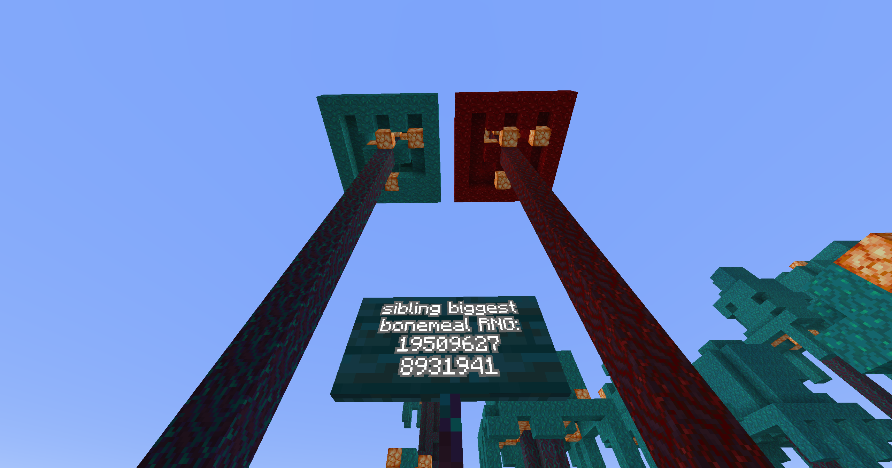

# Sibling trees

Warped and crimson fungi grow with almost the same code. If you bone meal a warped fungus and a crimson fungus while the game's random generator is in the same state, the two trees start out the same: same height, same hat width, same layers. They only drift apart when crimson draws a random number that warped doesn't, and that happens in two places:

- **The lowest three layers of the hat.** Cells on the outer ring get a hat block for free if there's already one underneath, and otherwise a 15% chance. Both variants place exactly the same blocks here, but every time the 15% roll succeeds, crimson draws one more number to decide whether a vine might hang from it. Warped skips that draw. It happens whether or not a vine ever appears, and it shifts every random number after it.
- **Higher up.** Both variants roll the vine chance the same way (warped's is just zero), so they stay in step until a crimson vine actually starts hanging. That needs the roll to hit and the block below to be empty, and then crimson draws more numbers.

So a roll can end up in one of three places:

- **Different.** The trees split early and look nothing alike. This is nearly every roll.
- **Sibling (same shape).** Both trees fill exactly the same blocks, stem and hat, but some of the wart and shroomlights can differ. Vines are ignored.
- **Identical sibling.** Same shape, and also wart and shroomlights in exactly the same places. The only thing that changes is which block types they're made of.

Identical siblings are rare, roughly 1 in 10,000 rolls. Siblings that match in shape but differ in wart or shroomlights are about 100 times rarer than that, around 1 in a million.



The pair above is `sibling_biggest`: one roll, grown as warped (left) and crimson (right). They fill exactly the same blocks.

Try one in game:

```
/stemkit sibling 69221
```

That grows the roll as warped on the left and crimson on the right and tells you which of the three it is. The catalogue has a few of the best ones (`sibling_most_glow`, `sibling_biggest`, `sibling_glow_ratio`), and [RESEARCH.md](RESEARCH.md#sibling-trees) covers how they were found.
